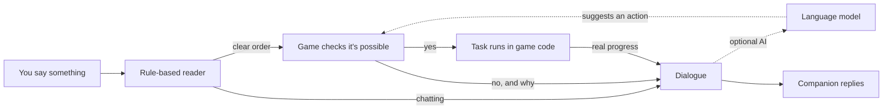

<div align="center">

# Hearthbound Companions

**RPG-style companions for Minecraft. Recruit them, talk to them, go on adventures together.**


</div>

I've always loved a good RPG companion: the one who carries way too much of your loot and has a
dry comment for every dungeon. Minecraft adventures feel a bit lonely in comparison, so I made
this: a mod that adds companions who look like players, have their own personalities, and
actually help you out.

You can walk up to one, ask them to join you, and from then on they follow you around, fight
next to you, chop wood when you ask, wander off to look at flowers when you stop to build, and
answer back when you talk to them in chat. Each one sounds different. Bram the sellsword
answers in about four words. Rosie the farm girl is scared of the dark and won't stop talking
about her gran.

## Meet the cast

There are twelve characters, two for each personality, and every one of them has their own
hand-made skin. You can also get wanderers who use the game's default skins (all nine of them,
with wide or slim arms).

| | Personality | Who they are |
|---|---|---|
| **Freya** | Sellsword | Golden-haired shieldmaiden from the north. Charges anything with teeth. |
| **Bram** | Sellsword | Scarred veteran who has outlived three mercenary companies. Not a talker. |
| **Hazel** | Naturalist | Auburn-haired ranger who stops to sketch every flower you walk past. |
| **Emmett** | Naturalist | Gentle herbalist with a sprig of something behind his ear. |
| **Cass** | Rogue | Treasure hunter with a sharp tongue. Pockets anything you leave on the ground. |
| **Lucas** | Rogue | Smooth-talking thief who calls you "partner" and means it, mostly. |
| **Daisy** | Guardian | Paladin with a gold circlet and a long braid. Will not hurt a villager, ever. |
| **Conoby** | Guardian | Retired rogue-knight with a rapier and a devilish grin. Has lost enough friends already. |
| **Rosie** | Farmhand | Flower crown, first real adventure, nervous about caves, adores every cow she meets. |
| **Samuel** | Farmhand | Farm lad who still isn't sure leaving home was a good idea. |
| **Luna** | Mystic | Silver-haired stargazer in a star-stitched cape. Likes the night more than you do. |
| **Casper** | Mystic | Young sorcerer in an emerald robe. Says very little, notices everything. |

<p align="center">
  
  
</p>

More about them (and how I drew the skins) in [docs/CAST.md](docs/CAST.md).

## What they can do

You talk to them in normal chat. `@Hazel follow me`, `Bram, get me 16 oak logs`,
`@all wait here`, or `@Cass tell me a joke`. Press **G** and the chat opens with the name of
whoever you're looking at already filled in. Every personality has around a hundred
situations of their own dialogue, so you're not hearing the same line over and over.

They take orders too: follow, wait, come here, gather stuff, hand items over, attack that thing,
stop what you're doing, go home. When they can't do something, they tell you why, in
character: there's no iron around here, they need a pickaxe for stone, their pack is full, or
"I don't build."

Stand still for a bit and they get bored. Hazel goes to study a
flower, Cass grabs loot you left lying around (and admits it), Rosie goes and pets the
nearest cow, the fighters walk a little guard circuit, and Luna stares at the stars at
night. They drop it the second you move or give an order. They also nag you to eat, suggest
finding shelter before dark, and bicker with each other.

On the move they keep a comfortable distance, hurry when you sprint off, and if you get
separated (or jump through a portal) they catch up next to you on safe ground. They warn you
about creepers and mobs sneaking up behind you.

By default they're knocked down instead of killed, so you never lose someone you've got attached to. Their name, personality, gear,
current task and memories all save with your world.

You can also right-click a companion with an item to give it to them. Everyone has
favourites (emeralds for Cass, bread for Rosie, amethyst for Luna), and it warms them up
towards you. Give a fighter a better sword and they'll equip it.

<p align="center">
  
  
</p>

## They don't lie to you

This is the part I cared about most. A lot of AI companion mods let a language model decide
what the character does, and you end up with a follower who says "Sure, I'll mine you some
diamonds!" and then stands there. I hate that.

So talking and doing are completely separate here:



Your message goes through a plain rule-based parser first. If it's an order, the game checks
whether it can actually happen, starts the task, and only then lets the companion answer. Progress
and "done" messages come straight from the task, so "Here's your 16 oak logs" only shows up once
the logs are in your inventory. If you hook up an AI model, it can only suggest an action from a
short list, and the game double-checks it the same way. If the game says no, the model's reply
gets thrown out and the companion tells you the real reason instead.

There's more detail in [ARCHITECTURE.md](docs/ARCHITECTURE.md) and [AI_DESIGN.md](docs/AI_DESIGN.md)
if you're into that.

## Installing

You'll need Minecraft Java Edition 26.3 with Fabric.

1. Install [Fabric Loader](https://fabricmc.net/use/installer/) (0.19.5 or newer) for 26.3.
2. Drop [Fabric API](https://modrinth.com/mod/fabric-api) into your `mods` folder.
3. Drop `hearthbound-0.2.0.jar` in there too (grab it from [Releases](../../releases)). Only want
   single player? v0.1.0 there is the version from before server support was added.
4. Launch the Fabric profile.

To meet someone quickly, grab a **Companion Spawn Egg** from the creative menu, or with cheats on
run `/companion summon hazel`. Walk up, right-click to say hi, then type `@Hazel will you join me?`.

| You want to | Type in chat | Or use a command |
|---|---|---|
| Recruit someone | `@Name join me` | `/companion recruit Name` |
| Follow / wait / come | `@Name follow me`, `wait here`, `come here` | `/companion follow Name` |
| Get resources | `@Name get me a stack of cobblestone` | `/companion gather Name 64 cobblestone` |
| Get your stuff back | `@Name give me everything` | `/companion give Name` |
| Fight something | look at it, `@Name attack that` | |
| Check on them | `@Name what are you doing?` | `/companion list` |
| Stop a task | `@Name stop` | `/companion cancel Name` |
| Swap items | sneak + right-click them | `/companion inventory Name` |
| Let them go | `@Name you're dismissed` | `/companion dismiss Name` |

Press **H** to hide the little party list in the corner.

## Playing on a server

You can also run it on a multiplayer server, and your friends don't need to install anything. With
[Polymer](https://modrinth.com/mod/polymer) on the server, companions show up for unmodded players as
player-shaped mannequins with a name tag and a little status line ("Sellsword · free to recruit").
Talking, recruiting and orders all work exactly the same.

On my own server the whole cast lives in the spawn hub, hanging around until someone asks them
along. Each player gets their own party, only you can give your companions orders, nobody can hurt
someone else's companion, and they won't break blocks near the hub or anyone's builds.

<p align="center">
  
</p>

Setup, the hub config and the multiplayer rules are in [docs/SERVER.md](docs/SERVER.md).

## Settings

The config lives at `config/hearthbound.json` and gets created the first time you play.

| Setting | Default | What it does |
|---|---|---|
| `essentialCompanions` | `true` | Knocked down instead of killed |
| `partyLimit` | `3` | How many companions you can have at once |
| `ambientChatter` | `1.0` | How much they talk on their own (0 is silent, 2 is very chatty) |
| `autonomy` | `1.0` | How often they wander off to do their own thing |
| `ai.provider` | `none` | `none`, `ollama`, `openai` or `anthropic` |

### Optional: AI conversations

Everything above works without any AI at all. If you want proper free-form conversations on top,
you can plug in a language model.

The option I'd recommend is **[Ollama](https://ollama.com)**, which runs on your own PC, costs
nothing, and keeps everything private. Install it, run `ollama pull qwen3.5:9b` (about 6.6 GB,
wants roughly 8 to 10 GB of graphics memory, or use `qwen3.5:4b` on smaller cards), and copy
[this config](docs/examples/hearthbound-ollama.json).

You can also use a cloud API: anything OpenAI-compatible (OpenAI, OpenRouter, Groq, LM Studio) or
Anthropic's Claude. Put your API key in an environment variable (`HEARTHBOUND_API_KEY`) or in
`config/hearthbound-secrets.json` ([example](docs/examples/hearthbound-secrets.example.json)),
never in the main config. A typical reply is cheap, around $0.03 per hundred messages on the
smallest models. Only your conversation with that one companion, a short memory, and a basic
description of where you are (biome, time, weather, health) gets sent. Your coordinates never are.

If the AI is slow or offline, companions just fall back to their own lines and orders keep working.

## Building it yourself

Gradle needs Java 25 (the one that comes with the Minecraft launcher works fine).

```bash
./gradlew build
```

That builds the jar into `build/libs/` and runs all the tests. If you want to poke around in a dev
copy of the game:

```bash
./gradlew runClient
```

The skins are generated by a small Python script, so you can tweak colours and rebuild them:

```bash
python tools/skins/cast.py
```

## Testing

I tried to test this properly instead of just eyeballing it. There are 113 unit tests (the chat
parser, the gathering logic, the AI response handling), 21 tests that run inside a real game
server (gathering logs and handing them over, cancelling halfway, catching up after a teleport,
saving and loading), and a few scripted runs in the actual game client. One of those drops two
companions into a normal generated world, walks them across the terrain, fights zombies at night,
goes to the Nether and back, then quits and reloads the world to check nothing got lost. It caught
a couple of real bugs along the way.

The full write-up, including what still needs testing, is in [TESTING.md](docs/TESTING.md).

## Known issues

- They use Minecraft's normal pathfinding, so they won't dig tunnels or build bridges. If something
  is out of reach (like the top of a tall tree) they'll say so and skip it.
- If you teleport really far and their chunk unloads before they notice, they'll stay put until you
  come back.
- Melee only for now, no bows.
- Talking happens in the chat box. A proper conversation screen is on my list.
- English only.
- On a server, unmodded players see default skins unless you set up signed skins or the resource
  pack ([how](docs/SERVER.md#skins-for-players-without-the-mod)).
- I haven't tried the AI side with a live model yet. It's tested against fake servers, but I still
  need to sit down with Ollama and play.

## What's next

A conversation screen with your history, companions who comment on each other more, bows, a way to
set a home for them, and more cast members. If you have ideas, open an issue!

## Credits

- Built on [Fabric](https://fabricmc.net/).
- The cast skins are my own originals, drawn with [`tools/skins/cast.py`](tools/skins/cast.py).
  Default skins come from the game itself at runtime; nothing from Mojang is copied here.
- Other Minecraft companion mods like CreatureChat, MCA Reborn and Human Companions were a big help
  in working out what I wanted ([research notes](docs/RESEARCH.md)).

Minecraft is a trademark of Mojang and Microsoft. This mod isn't affiliated with either of them.

## License

[MIT](LICENSE). Do what you like with it.
