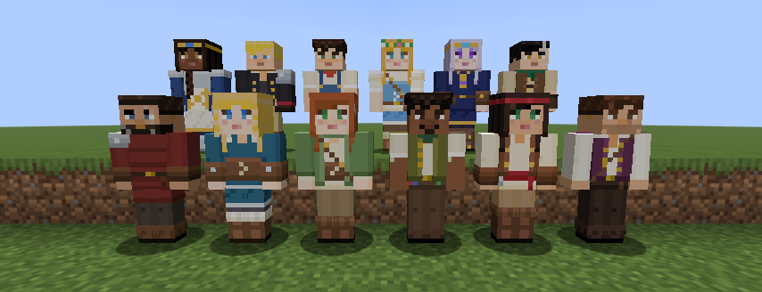
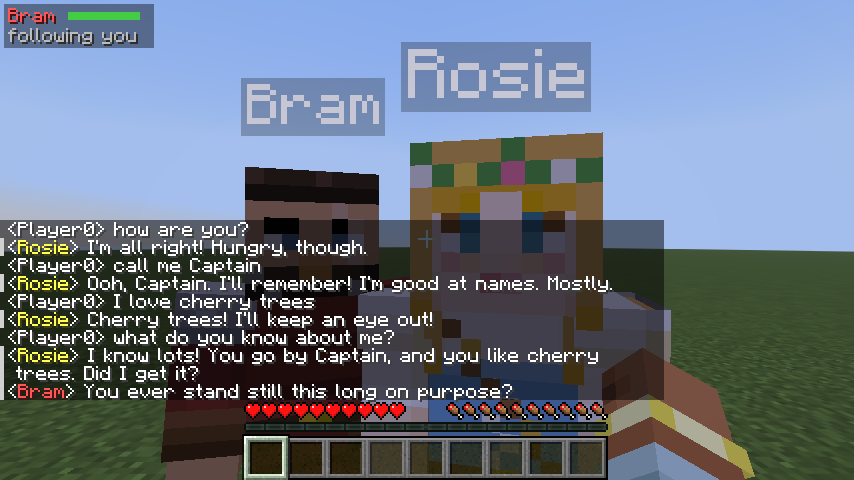
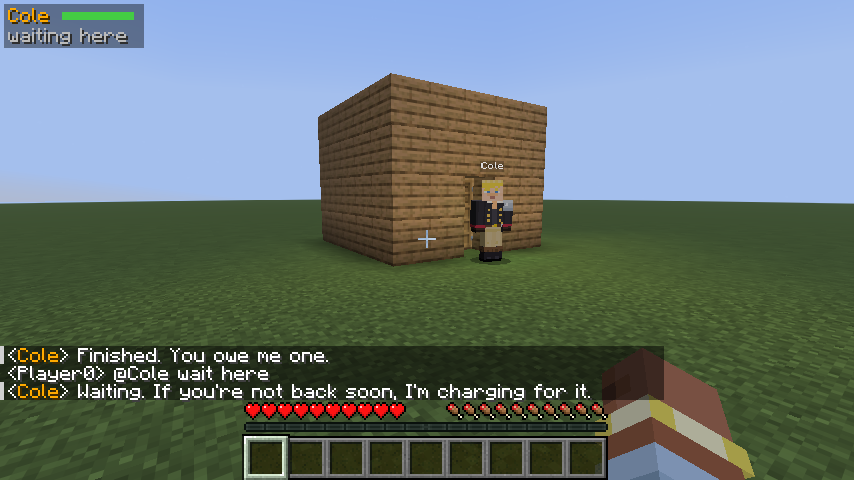
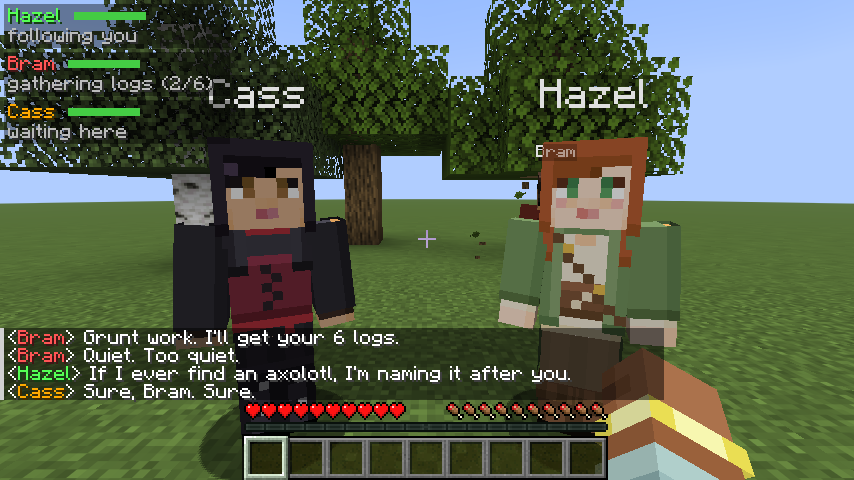
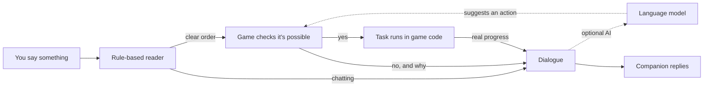
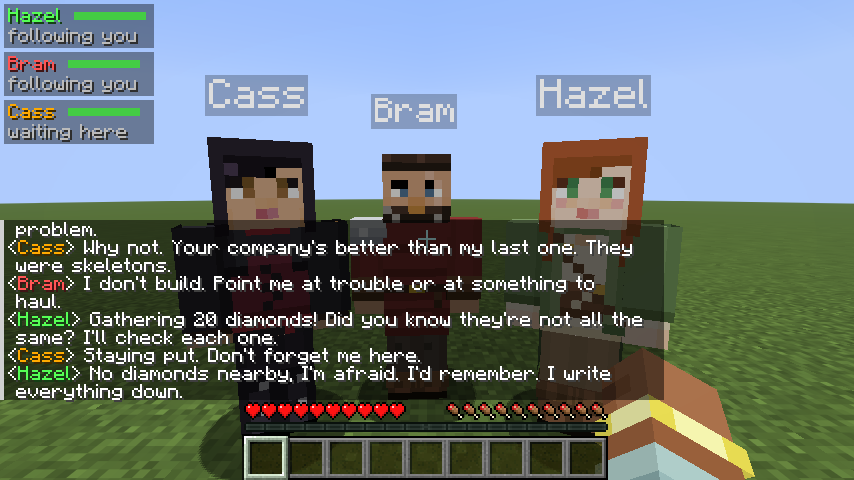
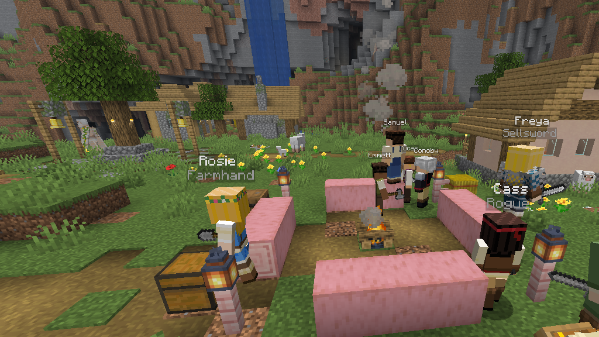

<div align="center">


# Hearthbound Companions

**RPG-style companions for Minecraft.**<br>
Recruit them, chat with them, and go on adventures together.

<a href="https://github.com/ColeCraven/hearthbound-companions/releases/latest"></a>
<a href="#install"></a>




**[Install](#install)** · **[Your first companion](#your-first-companion)** · **[What they can do](#what-they-can-do)** · **[Cheat sheet](#cheat-sheet)** · **[Servers](#playing-on-a-server)** · **[FAQ](#faq)**

</div>

<br>

I've always loved a good RPG companion: the one who carries way too much of your loot and has a
dry comment for every dungeon. Minecraft adventures feel a bit lonely in comparison, so I made
this: a mod that adds companions who look like players, have their own personalities, and actually
help you out.

Walk up to one, ask them to join you, and from then on they follow you around, fight next to you,
chop wood, dig, build, wander off to look at flowers when you stop, and talk back when you talk to
them. Each one sounds different. Charlie the sellsword answers in about four words. Honey the farm
girl is scared of the dark and won't stop talking about her gran.

- **Just talk.** It all happens in normal chat. Say hi once and keep typing, like you would with a friend.
- **They get to know you.** Tell them your nickname or what you love, and they remember it and bring it up later.
- **They pull their weight.** Gathering, mining trips, tunnels, shelters, walls, bridges and camps.
- **Everyone has a role.** Guardians fight best, builders build and dig fastest, collectors gather
  quickest and farmers farm best, but anyone can do any job.
- **They never fake it.** If they say they'll do something, the game is really doing it. If they can't, they tell you why.
- **Works on servers** with nothing for your friends to install.

<br>

## Install

> [!TIP]
> Joining a server that already runs Hearthbound? You don't need to install anything. Just join and say hi.

You need **Minecraft: Java Edition 26.3** on Windows, Mac or Linux. Setup takes about five minutes.

**1. Install Fabric.** Grab the [Fabric installer](https://fabricmc.net/use/installer/), run it, set
the Minecraft version to **26.3** and click **Install**. That adds a Fabric profile to your Minecraft
Launcher.

**2. Download the mod.** From the [latest release](https://github.com/ColeCraven/hearthbound-companions/releases/latest),
download **`Hearthbound-Companions-0.3.0-install-kit.zip`**. It has the mod, Fabric API (a library
the mod needs) and a step-by-step guide.

**3. Drop two files into your `mods` folder.** Unzip the kit and copy both `.jar` files into `mods`:

| Windows | Mac | Linux |
|---|---|---|
| Press <kbd>Win</kbd> + <kbd>R</kbd>, paste `%appdata%\.minecraft` and press Enter | In Finder press <kbd>Cmd</kbd> + <kbd>Shift</kbd> + <kbd>G</kbd> and go to `~/Library/Application Support/minecraft` | `~/.minecraft` |

Open the `mods` folder in there. If it doesn't exist yet, just make one.

**4. Play.** Open the Minecraft Launcher, pick **fabric-loader-26.3** next to the Play button, and hit Play.

> [!IMPORTANT]
> Once a world has companions in it, only open it with the Fabric profile. Plain Minecraft doesn't
> know what a companion is and quietly removes them from the world.

<details>
<summary><b>Using Prism, the Modrinth App or CurseForge instead?</b></summary>
<br>

Make a new instance for Minecraft 26.3 with Fabric, then drop `hearthbound-0.3.0.jar` and
[Fabric API](https://modrinth.com/mod/fabric-api) into that instance's `mods` folder. That's it.

</details>

<br>

## Your first companion

1. Create a world with **Allow Commands** turned on (or play in Creative).
2. Summon someone. Type `/companion summon honey` in chat. Any of the cast works: `dasha`, `charlie`,
   `hazel`, `birintan`, `maddie`, `aj`, `daisy`, `cole`, `honey`, `samuel`, `luna`, `luke`.
   In Creative there's also a **Companion Spawn Egg** in the Spawn Eggs tab.
3. Say hi. Right-click her, or type `@Honey hi!`.
4. Ask her along with `@Honey join me`.
5. Now just talk. Try "how are you?", "follow me", "get me 16 oak logs" or "build a shelter".

> [!TIP]
> Survival world with cheats off? Press Esc, choose **Open to LAN**, turn on **Allow Commands** and
> click **Start LAN World**. Commands work until you quit, and the world is back to normal next time.

Forgot something? `/companion help` lists everything you can say and do, right in game.

<br>

## What they can do

### Just talk to them

Say hi with `@Honey hi!` (or right-click her) and after that you can keep chatting like you would
with anyone: "how are you?", "tell me about your family", "what should we do today?". No @ needed
until you say bye or wander off, and a typo in a name (`@rsoie`) still gets through. Orders work
the same way: `@Hazel follow me`, `Charlie, get me 16 oak logs`, `@party wait here`. Press <kbd>G</kbd>
and the chat opens with the name of whoever you're looking at already filled in.

You can say "this" and "that" too: look at a log and say `collect that`, or look at a zombie and say
`fight that`. If a request is too vague (`build this`) they ask one short question and use your
answer. `@party` is everyone with you, and `@everyone` is every companion you have, wherever they are
(they have to be in the same dimension and in a loaded chunk to hear you, and you get a short report
of who did). The full list is in [GUIDE.md](docs/GUIDE.md).

Every personality has well over a hundred situations of their own dialogue, so you're not hearing
the same line over and over.

### They get to know you

Tell one "call me Captain" and that's what they call you from then on. Tell them you love the
ocean and they'll point it out when you get to one. When things are quiet they ask you stuff
("What should I call you, anyway?", "What's your favourite thing to find down a mine?") and
remember the answer. Ask "what do you know about me?" and they'll tell you.

<p align="center">
  
</p>

They notice what you're up to as well. They cheer when you get an advancement or find diamonds,
say goodnight when you go to bed and ask how you slept in the morning, and panic when you die.
Crouch twice while looking at one and they'll crouch back. If you're starving and they have food
on them, they hand some over, and the ones who like you sometimes give you a flower they picked
on the way.

### They pull their weight

Follow, wait, come here, gather stuff, hand items over, attack that thing, stop, go home. And some
proper jobs:

- **Dig.** "go mining" digs a staircase down and then a tunnel along, grabbing any ores next to it.
  "dig a tunnel" and "dig down 20" do one or the other. They need a pickaxe, put torches up if they
  carry some, and stop before lava, water or a big drop.
- **Build.** "build a shelter", "build a wall" or "build a bridge" (across water or a gap in front of
  you), using blocks from their pack. A shelter gets a door and a torch if they have them. "set up
  camp" puts down a campfire with three seats, if they carry a campfire.
- **Roles.** Guardians hit harder and take more punishment, builders place and dig faster,
  collectors gather faster and farmers harvest crops faster. Nobody is ever blocked from a job,
  and they'll tell you whether it suits them. On a server the role is the grey line under a
  stranger's name.

<p align="center">
  
  
</p>

When they can't do something, they tell you why, in character: there's no iron around here, they
need a pickaxe, the ground's too uneven to build on, they're short on blocks.

### They have a life of their own

Stand still for a bit and they get bored. Hazel goes to study a flower, Maddie grabs loot you left
lying around (and admits it), Honey pets the nearest cow, the fighters walk a little guard circuit,
and Luna stares at the stars at night. They drop it the second you move or give an order. They
also nag you to eat, suggest finding shelter before dark, and have short chats with each other.
If you'd like them to be more useful on their own, `/companion autonomy on` lets idle companions
pick jobs that suit their role (chopping a tree, harvesting a ripe crop, lighting a dark spot,
dealing with a nearby zombie). It's off by default, and your orders always win.

Too chatty? `/companion chattiness low` (or `off`) quietens the comments. They still answer you,
confirm orders and warn you about danger.

On the move they keep a comfortable distance, hurry when you sprint off, and if you get separated
(or jump through a portal) they catch up next to you on safe ground. They warn you about creepers
and mobs sneaking up behind you. By default they're knocked down instead of killed, so you never
lose someone you've got attached to.

Right-click one with an item to give it to them. Everyone has favourites (emeralds for Maddie, bread
for Honey, amethyst for Luna), and it warms them up towards you. Give a fighter a better sword and
they'll use it. Their name, personality, gear, current task and memories all save with your world.

### They don't lie to you

This is the part I cared about most. A lot of AI companion mods let a language model decide what
the character does, and you end up with a follower who says "Sure, I'll mine you some diamonds!"
and then stands there. I hate that.

So talking and doing are completely separate here:



Your message goes through a plain rule-based parser first. If it's an order, the game checks
whether it can actually happen, starts the task, and only then lets the companion answer. Progress
and "done" messages come straight from the task, so "Here's your 16 oak logs" only shows up once
the logs are in your inventory. If you hook up an AI model, it can only suggest an action from a
short list, and the game double-checks it the same way. If the game says no, the model's reply gets
thrown out and the companion tells you the real reason instead.

<p align="center">
  
</p>

<br>

## Meet the cast

There are twelve characters, each with a role and a voice, and every one of them has their own
hand-made skin. You'll also meet wanderers who use the game's default skins (all nine of them,
with wide or slim arms).

| | Role | Voice | Who they are |
|---|---|---|---|
| **Charlie** | Guardian | Sellsword | Gruff, funny veteran with a clay pipe and a pouch of herbs. Has outlived three mercenary companies. |
| **Dasha** | Guardian | Guardian | Golden-haired shieldmaiden from the north. Charges anything with teeth. |
| **AJ** | Guardian | Rogue | The funny one. Keeps trying his luck and never gets anywhere. Takes it well. |
| **Cole** | Guardian | Rogue | Cheeky, quick-witted adventurer with a rapier and a devilish grin. |
| **Maddie** | Builder | Rogue | Sharp-tongued builder in a crimson bandana. Pockets anything you leave on the ground. |
| **Birintan** | Builder | Naturalist | Curious, clever herbalist with a sprig of something behind his ear. Works out how it all fits together. |
| **Luke** | Builder | Mystic | Young sorcerer in an emerald robe who shapes stone like a spell. Says very little, notices everything. |
| **Hazel** | Collector | Naturalist | Auburn-haired ranger who stops to sketch every flower you walk past. |
| **Daisy** | Collector | Guardian | Woodland warden with a gold circlet and a long braid. Will not hurt a villager, ever. |
| **Luna** | Collector | Mystic | Silver-haired stargazer in a star-stitched cape. Likes the night more than you do. |
| **Samuel** | Farmer | Farmhand | Farm lad who still isn't sure leaving home was a good idea. |
| **Honey** | Farmer | Farmhand | Flower crown, first real adventure, nervous about caves, adores every cow she meets. |

<p align="center">
  
  
  
</p>

More about them (and how I drew the skins) in [CAST.md](docs/CAST.md), and how the six
personalities differ in [PERSONALITIES.md](docs/PERSONALITIES.md).

<br>

## Cheat sheet

| You want to | Type in chat | Or use a command |
|---|---|---|
| Recruit someone | `@Name join me` | `/companion recruit Name` |
| Follow / wait / come | `@Name follow me`, `wait here`, `come here` | `/companion follow Name` |
| Get resources | `@Name get me a stack of cobblestone` | `/companion gather Name 64 cobblestone` |
| Get your stuff back | `@Name give me everything` | `/companion give Name` |
| Fight something | look at it, `@Name attack that` | |
| Dig | `@Name go mining`, `dig a tunnel`, `dig down 20` | |
| Build | `@Name build a shelter` (or a wall, a bridge, `set up camp`) | |
| Use what you're looking at | `collect that`, `fight that`, `build this` (they ask what you mean if it's unclear) | |
| Tell them about you | `call me Captain`, `I love the ocean` | |
| Check on them | `@Name what are you doing?` | `/companion list` |
| Stop a task | `@Name stop` | `/companion cancel Name` |
| Swap items | sneak + right-click them | `/companion inventory Name` |
| Let them go | `@Name you're dismissed` | `/companion dismiss Name` |
| Talk to everyone with you | `@party follow me` (or `@all`) | `/companion tell party follow me` |
| Talk to every companion you have | `@everyone come to me` | `/companion tell everyone come to me` |
| Make them quieter | | `/companion chattiness low` (or `off`, `normal`, `high`) |
| Let them pick their own jobs | | `/companion autonomy on` |
| See everything | `@Name what can you do?` | `/companion help` |

| Key | What it does |
|---|---|
| <kbd>G</kbd> | Opens chat with the name of the companion you're looking at |
| <kbd>H</kbd> | Shows or hides the party list in the corner |
| Right-click | Say hi, or hand over the item you're holding |
| Sneak + right-click | Open their pack |
| Crouch twice | Say hello the Minecraft way |

<br>

## Playing on a server

You can run Hearthbound on a multiplayer server too, and your friends don't need to install
anything. With [Polymer](https://modrinth.com/mod/polymer) on the server, companions show up for
unmodded players as player-shaped mannequins with a name tag and a short grey line under it (their
role, or who they're travelling with). Talking, recruiting and orders all work exactly the
same.

On my own server the whole cast lives at a hub, hanging around until someone asks them along. Each
player gets their own party, only you can give your companions orders, nobody can hurt someone
else's companion, and they won't break blocks near the hub or anyone's builds.

<p align="center">
  
</p>

Setup, the hub config and the multiplayer rules are in [SERVER.md](docs/SERVER.md).

<br>

## Settings

<details>
<summary><b>The config file</b></summary>
<br>

The config lives at `config/hearthbound.json` and gets created the first time you play.

| Setting | Default | What it does |
|---|---|---|
| `essentialCompanions` | `true` | Knocked down instead of killed |
| `partyLimit` | `3` | How many companions you can have at once |
| `ambientChatter` | `1.0` | How much they talk on their own (0 is silent, 2 is very chatty) |
| `autonomy` | `1.0` | How often they wander off to do their own thing |
| `routines` | `false` | Let idle companions pick jobs that suit their role (`/companion autonomy on`) |
| `ai.provider` | `none` | `none`, `ollama`, `openai` or `anthropic` |

</details>

<details>
<summary><b>Optional: AI conversations</b></summary>
<br>

Everything above works without any AI at all. If you want proper free-form conversations on top,
you can plug in a language model.

The option I'd recommend is **[Ollama](https://ollama.com)**, which runs on your own PC, costs
nothing, and keeps everything private. Install it, run `ollama pull qwen3.5:9b` (about 6.6 GB,
wants roughly 8 to 10 GB of graphics memory, or use `qwen3.5:4b` on smaller cards), and copy
[this config](docs/examples/hearthbound-ollama.json).

You can also use a cloud API: anything OpenAI-compatible (OpenAI, OpenRouter, Groq, LM Studio) or
Anthropic's Claude. Put your API key in an environment variable (`HEARTHBOUND_API_KEY`) or in
`config/hearthbound-secrets.json` ([example](docs/examples/hearthbound-secrets.example.json)),
never in the main config. A typical reply is cheap, around $0.03 per hundred messages on the
smallest models. Only your conversation with that one companion, a short memory, and a basic
description of where you are (biome, time, weather, health) gets sent. Your coordinates never are.

If the AI is slow or offline, companions just fall back to their own lines and orders keep working.
More detail in [AI_DESIGN.md](docs/AI_DESIGN.md).

</details>

<br>

## FAQ

<details>
<summary><b>The game won't start, or it says Fabric API is required</b></summary>
<br>

Make sure both jars from the kit are in your `mods` folder: `hearthbound-0.3.0.jar` and
`fabric-api-0.164.0+26.3.jar`. If the error mentions a Minecraft version, re-run the Fabric
installer and pick 26.3.

</details>

<details>
<summary><b>The game starts, but nothing's different</b></summary>
<br>

You probably launched "Latest release" instead of **fabric-loader-26.3**. Pick the Fabric profile
next to the Play button. The title screen mentions Fabric in the corner when it worked.

</details>

<details>
<summary><b>It says "Unknown command" when I type /companion</b></summary>
<br>

Commands are off in that world. Use the Open to LAN trick from [Your first companion](#your-first-companion),
or grab a spawn egg in Creative. Talking to companions with `@Name` works without commands.

</details>

<details>
<summary><b>A companion doesn't answer me</b></summary>
<br>

Check the name is spelled close enough, with @ in front, and that you're within about 60 blocks.
If you're chatting with friends nearby, look at the companion you're talking to, so your chat with
people isn't taken over.

</details>

<details>
<summary><b>Does it work with other mods?</b></summary>
<br>

It should. I've run it alongside Lithium, FerriteCore, Polymer, Ledger and Universal Graves on a
server without problems. If something clashes, please open an issue.

</details>

<details>
<summary><b>Bedrock, consoles or phones?</b></summary>
<br>

Sorry, Java Edition only. Bedrock players can't join a Java server running it either.

</details>

<br>

## For the curious

<details>
<summary><b>Building it yourself</b></summary>
<br>

Gradle needs Java 25 (the one that comes with the Minecraft launcher works fine).

```bash
./gradlew build
```

That builds the jar into `build/libs/` and runs all the tests. If you want to poke around in a dev
copy of the game:

```bash
./gradlew runClient
```

The skins are generated by a small Python script, so you can tweak colours and rebuild them:

```bash
python tools/skins/cast.py
```

</details>

<details>
<summary><b>Testing</b></summary>
<br>

I tried to test this properly instead of just eyeballing it. There are 264 unit tests (the chat
parser, reading answers to the companions' own questions, the gathering logic, the AI response
handling), 47 tests that run inside a real game server (gathering logs and handing them over,
digging a tunnel, stopping before lava, building a shelter, a bridge and a camp, orders typed in
plain chat with several companions around, "collect that" at a log, a question and its answer,
remembering a nickname, reacting to an advancement, saving and loading), and a few scripted runs in the actual game client.
One of those drops two companions into a normal generated world, walks them across the terrain,
fights zombies at night, goes to the Nether and back, then quits and reloads the world to check
nothing got lost. It caught a couple of real bugs along the way.

The full write-up, including what still needs testing, is in [TESTING.md](docs/TESTING.md).

</details>

<details>
<summary><b>How it's put together</b></summary>
<br>

- [ARCHITECTURE.md](docs/ARCHITECTURE.md): how a chat message becomes a real action in the world
- [AI_DESIGN.md](docs/AI_DESIGN.md): the optional AI side, prompts, costs and privacy
- [TECH_DECISIONS.md](docs/TECH_DECISIONS.md): why Fabric, why a mob with a player model, and more
- [PERSONALITIES.md](docs/PERSONALITIES.md): the six archetypes and what they change
- [SERVER.md](docs/SERVER.md): running it for friends with no client mod
- [RESEARCH.md](docs/RESEARCH.md): what I looked at before starting
- [CHANGELOG.md](CHANGELOG.md): what changed in each version

</details>

<br>

## Known issues

- They dig and build when you ask, but not on their own to get somewhere. If something is out of
  reach (like the top of a tall tree) they'll say so and skip it.
- If you teleport really far and their chunk unloads before they notice, they'll stay put until you
  come back.
- Melee only for now, no bows.
- Talking happens in the chat box. A proper conversation screen is on my list.
- English only.
- On a server, unmodded players see default skins unless you set up signed skins or the resource
  pack ([how](docs/SERVER.md#skins-for-players-without-the-mod)).
- I haven't tried the AI side with a live model yet. It's tested against fake servers, but I still
  need to sit down with Ollama and play.

## What's next

A conversation screen with your history, bows, a way to set a home for them, more things to build,
and more cast members. If you have ideas, open an issue!

## Credits

- Built on [Fabric](https://fabricmc.net/), with [Polymer](https://modrinth.com/mod/polymer) for server support.
- The cast skins are my own originals, drawn with [`tools/skins/cast.py`](tools/skins/cast.py).
  Default skins come from the game itself at runtime; nothing from Mojang is copied here.
- Other Minecraft companion mods like CreatureChat, MCA Reborn and Human Companions were a big help
  in working out what I wanted ([research notes](docs/RESEARCH.md)).

Minecraft is a trademark of Mojang and Microsoft. This mod isn't affiliated with either of them.

## License

[MIT](LICENSE). Do what you like with it.
