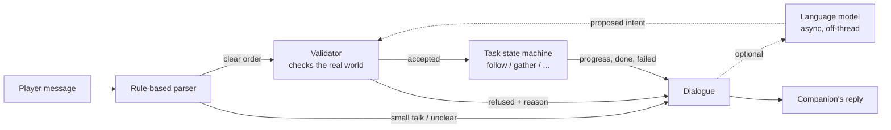
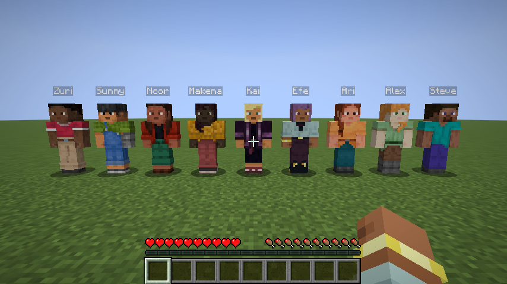
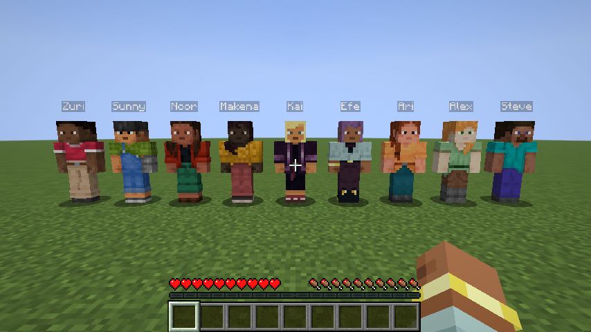
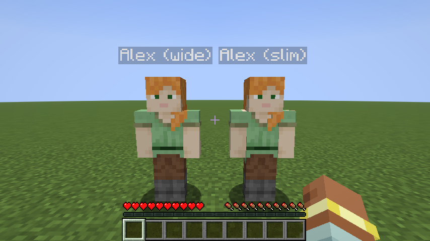

# Hearthbound Companions

*RPG-style followers for single-player Minecraft: recruit them, talk to them, and
adventure together.*


Hearthbound adds companions who look like players, each with their own personality. Ask one to
join you, and they'll follow you through forests, caves and portals, fight beside you, wait where
you tell them, and fetch resources. Talk to them in plain English in the normal chat box. Optionally,
connect a local or cloud language model for free-form conversation. Either way, **companions only
agree to what they will actually do, and only report what really happened.**

| | |
|---|---|
| **Minecraft** | Java Edition **26.3** |
| **Loader** | **Fabric** Loader 0.19.5+ with Fabric API 0.164.0+26.3 |
| **Java** | 25 (bundled with the Minecraft launcher) |
| **Status** | v0.1 preview - core features working and tested; see [Known limitations](#known-limitations) |
| **License** | MIT |

## Features

**Companions that look like players**
- All nine default player skins shipped with the game (Steve, Alex, Ari, Efe, Kai, Makena, Noor,
  Sunny, Zuri), each with both wide (4 px) and slim (3 px) arms - 18 looks.
- Rendered with the game's own player model and skin textures, read at runtime; no Mojang art is
  copied into this repository. Armour and held items show as on players.

**Six real personalities** - not just different names ([details](docs/PERSONALITIES.md)):

| Archetype | Voice | Helps by |
|---|---|---|
| Sellsword | Terse, deadpan soldier | Charges any hostile nearby; retreats only at 20 % health |
| Naturalist | Curious, punny scholar | Spots ores and biomes; fights only when attacked |
| Rogue | Teasing treasure hunter | Flanks mobs that target you; points out chests and loot |
| Guardian | Formal, earnest protector | Stays closest; defends you; refuses to harm villagers or pets |
| Farmhand | Nervous, kind farm kid | Warns early, retreats early; won't hurt farm animals |
| Mystic | Dry, cryptic wanderer | Aggressive at night, aloof by day; warns about lava |

Each archetype has around 90 situations of scripted dialogue (orders, refusals, progress, combat,
weather, biomes, small talk), with no-repeat selection so lines don't loop.

**Clear, reliable orders**
- **Follow** - keeps a personal distance, hurries when you get ahead, and teleports to a safe spot
  next to you when separated, stuck, or when you go through a portal.
- **Wait** - holds a spot and returns to it after a fight.
- **Come** - walks to you once.
- **Gather** *N* *items* - logs, stone, dirt, sand, gravel, clay, ores, flowers, sugar cane,
  pumpkins... Only natural blocks (no dismantling your house), using the best tool the companion
  carries, at normal breaking speed. The items are brought back and handed to you.
- **Give** - hands over everything, or a specific item.
- **Attack** - fight the creature you're looking at (or name one).
- **Cancel / stop** - drops the current task.
- **Recruit / dismiss** - up to 3 companions at a time; dismissed companions walk home.

When a request can't be done, companions say why, in character: the item isn't gatherable,
there's none within reach, they need a stone pickaxe, their pack is full, they won't attack a
villager, or "I don't build."

**Adventuring**
- Essential by default: at zero health a companion is knocked down for 15 seconds instead of dying.
- Warnings when a creeper is close, a mob is behind you, your health is low, or there's lava nearby.
- Comments on nightfall, rain, caves and new biomes, with cooldowns and a chattiness setting.
- Auto-equips armour and the best sword or axe you put in their pack.

**Talking**
- Address a companion in normal chat: `@Wren follow me`, `Bram, gather 16 oak logs`, `@all wait here`.
- Press **G** to start a message to the companion you're looking at (or the last one you spoke to).
- A small party list (top left, toggle with **H**) shows each companion's task and health.

**Persistence**
- Name, personality, skin, owner, current order (including an unfinished gather), inventory,
  recent conversation, notable shared events and affinity are saved with the world.

## How it works

The rule that shapes the whole design: **talking and doing are separate systems.**



1. Messages are first read by a deterministic parser (tested with 58 cases).
2. Orders are validated against the actual game: does the item exist, can it be gathered, does the
   companion have the right tool, are they recruited, would their personality refuse?
3. Only after the order has started (or been refused) does the companion reply, so the reply always
   matches what is really happening.
4. Progress and completion come from the task's state machine ("Only found 5 of the 16 oak logs,
   that's all there is"). A task is only reported complete when the items are in your inventory.
5. An optional language model can make conversation richer, but it can only *propose* an intent
   from a fixed list. The game validates it exactly like a typed order. If the game refuses, the
   model's reply is discarded and the truthful refusal is shown. A guard also replaces replies that
   promise actions nobody started ("Sure, I'll build you a tower!").

More detail: [Architecture](docs/ARCHITECTURE.md), [AI design](docs/AI_DESIGN.md),
[technical decisions](docs/TECH_DECISIONS.md), [research](docs/RESEARCH.md), [plan](docs/PLAN.md).

## Installation

1. Install [Fabric Loader](https://fabricmc.net/use/installer/) 0.19.5 or newer for Minecraft 26.3.
2. Put [Fabric API](https://modrinth.com/mod/fabric-api) (0.164.0+26.3 or newer) in your `mods` folder.
3. Put `hearthbound-0.1.0.jar` (from [Releases](../../releases) or built yourself) in `mods`.
4. Start the game with the Fabric profile.

### Getting a companion

- In Creative, use the **Companion Spawn Egg** (Spawn Eggs tab), or with cheats run
  `/companion summon [archetype] [name] [skin] [wide|slim]`, e.g. `/companion summon guardian Seren noor slim`.
- Walk up, right-click to say hello, then say `@Seren will you join me?`.

### Talking and commands

| Do this | By typing (chat) | Or |
|---|---|---|
| Recruit | `@Name join me` | `/companion recruit Name` |
| Follow / wait / come | `@Name follow me`, `wait here`, `come here` | `/companion follow Name` ... |
| Gather | `@Name get me a stack of cobblestone`, `chop 10 birch logs` | `/companion gather Name 64 cobblestone` |
| Hand over items | `@Name give me everything`, `hand over the logs` | `/companion give Name` |
| Fight | `@Name attack that` (look at it) | |
| Status | `@Name what are you doing?` | `/companion list` |
| Stop the current task | `@Name stop` | `/companion cancel Name` |
| Trade items | sneak + right-click, or `@Name show me your pack` | `/companion inventory Name` |
| Dismiss | `@Name you're dismissed` | `/companion dismiss Name` |
| Everyone at once | `@all follow me` | |

## Configuration

`config/hearthbound.json` is created on first launch ([example](docs/examples/hearthbound.json)):

| Setting | Default | Meaning |
|---|---|---|
| `essentialCompanions` | `true` | Knocked down instead of killed |
| `partyLimit` | `3` | Companions per player |
| `ambientChatter` | `1.0` | 0 = silent, 2 = chatty |
| `ai.provider` | `none` | `none`, `ollama`, `openai` (any OpenAI-compatible API), `anthropic` |

### Optional AI dialogue

The mod is complete without AI. If you want free-form conversation:

**Local and private (recommended): [Ollama](https://ollama.com)**
1. Install Ollama and run `ollama pull qwen3.5:9b` (about 6.6 GB; needs about 8-10 GB of VRAM).
   With 4-8 GB, use `qwen3.5:4b`.
2. Use [this config](docs/examples/hearthbound-ollama.json). Nothing leaves your computer.

**Cloud: OpenAI-compatible APIs (OpenAI, OpenRouter, Groq, LM Studio...) or Anthropic**
1. Set `ai.provider`, `ai.model` (and `ai.baseUrl` for non-OpenAI services), e.g.
   [Anthropic example](docs/examples/hearthbound-anthropic.json).
2. Provide your API key **outside the config**, either as an environment variable
   (`HEARTHBOUND_API_KEY`, or `OPENAI_API_KEY` / `ANTHROPIC_API_KEY`), or in
   `config/hearthbound-secrets.json` (see the [example](docs/examples/hearthbound-secrets.example.json)).
   Keys are never logged, never sent to the game client, and never put in prompts.
3. Costs are small but real: a typical reply is about 1,500 tokens in and 150 out. That's roughly
   $0.03 per 100 replies with `claude-haiku-5-5`, and about $1 per 100 with `claude-opus-5-5` at low
   effort. See [AI design](docs/AI_DESIGN.md) for other providers and sources.
4. Privacy: only the conversation with that companion, a short memory summary, and a compact world
   description (biome, time, weather, health, nearby mob types) are sent. Set
   `ai.sharePlayerName: false` to hide your name. Coordinates and other players' chat are never sent.

If the AI service is slow, offline or returns something unusable, companions answer with their
scripted lines instead. After three failures in a row the AI is paused for two minutes. Orders always
work.

## Building from source

```bash
./gradlew build
```

This compiles the mod, runs the unit tests and the in-game GameTests, and writes the jar to
`build/libs/`. Gradle needs Java 25; the Minecraft launcher's runtime works, or any JDK 25.

```bash
./gradlew runClient
```

```bash
./gradlew runClientGameTest
```

`runClient` starts a development game. `runClientGameTest` opens a game window, runs scripted
playtests and saves screenshots to `build/run/clientGameTest/screenshots`.

## Testing

| Layer | What | Count |
|---|---|---|
| Unit tests (JUnit 5) | Command parser, gather state machine, follow/stuck logic, line banks for every personality, AI JSON contract, promise guard, prompt building, all three AI clients against a fake HTTP server (success, refusal, HTTP errors, timeouts) | 101 |
| Server GameTests | In a real world: gathering and handing over, "nothing found", "needs a pickaxe", cancelling mid-task, catch-up teleport, knocked down not killed, refusing to attack villagers, strangers refusing orders, party limit, save/load round trip | 10 |
| Client GameTest | Real client: renders all 18 looks, recruits a party through chat, gives orders, gathers wood; takes screenshots | 1 scripted session |

What has been verified and what still needs testing is tracked honestly in [docs/TESTING.md](docs/TESTING.md).

## Screenshots

| | |
|---|---|
|  |  |
| All nine default skins, wide arms | ...and slim arms |
|  |  |
| Same skin, both models | Gathering logs from real trees |

## Known limitations

- **Movement is vanilla pathfinding.** Companions don't dig tunnels, build bridges or pillar up, so
  they only gather blocks they can reach on foot (tall trees keep their top logs). When they can't
  reach something they say so instead of pretending.
- **Separation edge case:** if you teleport far away and the companion's chunk unloads before its
  next check (about once a second), it stays where it was until you return.
- **Melee only**, no bows. Companions regenerate slowly but don't eat.
- **Conversation uses the chat box.** There's no dedicated conversation screen yet.
- **English only.** Single-player focus; multiplayer hasn't been tested.
- **AI dialogue** is fully implemented and covered by tests against fake servers, but at the time of
  writing it hadn't been playtested with a live model.

## Credits

- Built with [Fabric](https://fabricmc.net/) (Loader, Loom, Fabric API).
- Skins, models and textures are Minecraft's own, used at runtime; Minecraft is a trademark of Mojang/Microsoft. This mod is not affiliated with Mojang or Microsoft.
- Inspired by the RPG companions I've always liked, and the companion mods that came before this one.
- Prior art studied: CreatureChat, Mindcraft, MCA Reborn, Human Companions, Villager Recruits and others (see [research](docs/RESEARCH.md)).
- Developed by Tekless with AI assistance (Claude).

## License

[MIT](LICENSE) for the code and the original assets in this repository (icon, spawn egg texture, dialogue text).
