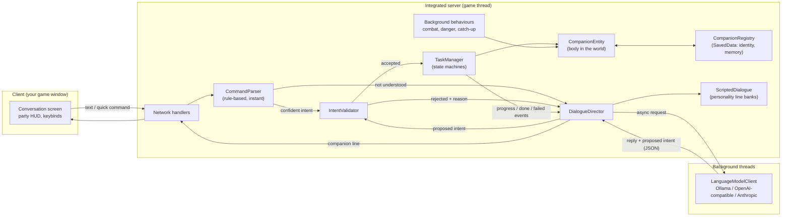
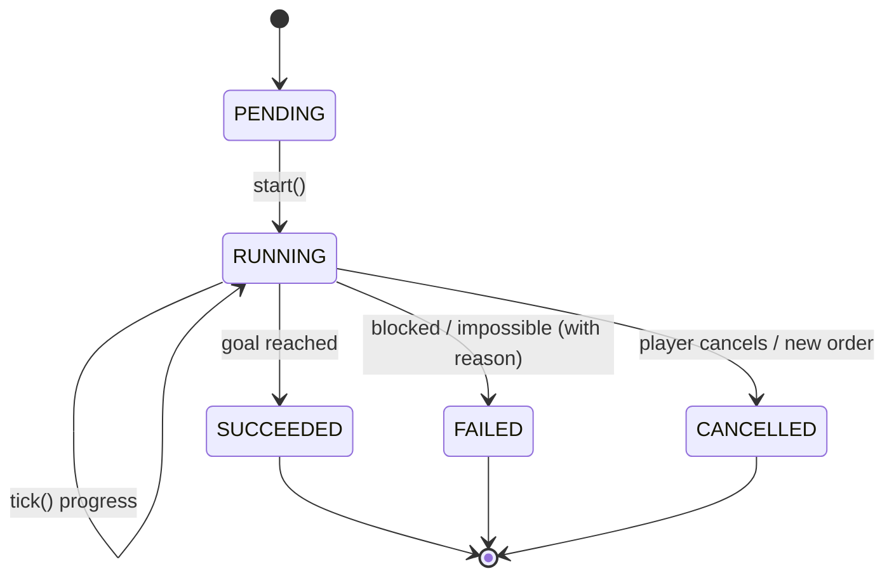

# Architecture

This document explains how Hearthbound Companions is put together and, more importantly, *why*.
The single most important rule is:

> **Talking and doing are separate systems.** Dialogue (scripted or AI-generated) can only
> *propose* a structured intent. Deterministic game code validates it, runs it, and is the only
> source of truth for what a companion is doing.

## Big picture

## Layers

| Layer | Package | Depends on Minecraft? | Purpose |
|---|---|---|---|
| Core logic | `hearthbound.core.*` | **No** | Intent model, command parser, validator rules, task state machine contract, personality model, dialogue selection, prompt building, JSON contract for AI replies. Plain Java so it can be unit-tested quickly with JUnit. |
| Game integration | `hearthbound.entity`, `hearthbound.task`, `hearthbound.world` | Yes (server) | The companion entity, concrete tasks (follow, wait, gather, defend), navigation helpers, saved data. |
| AI providers | `hearthbound.ai` | No (uses `java.net.http` + Gson) | Async HTTP clients for Ollama, OpenAI-compatible APIs and Anthropic. Never called on the game thread. |
| Networking | `hearthbound.network` | Yes | Custom packets between client UI and server. |
| Client | `hearthbound.client` | Yes (client only) | Renderer using the game's own default skins, conversation screen, HUD, keybinds. |

## How a message flows

1. The player types *"Hazel, gather 16 oak logs"* in the conversation screen (or `@Hazel ...` in chat).
2. The server receives it on the game thread. `CommandParser` (rule-based, a few microseconds)
   recognises `gather(item=oak_log, count=16)`.
3. `IntentValidator` checks it against the real world: is it a known item, can this mod gather it,
   is the count sane, does the companion have the required tool, are they downed/dismissed?
4. **Accepted:** `TaskManager` starts a `GatherTask`. Only *then* is a reply produced, and the reply
   is told the real outcome ("task started"). **Rejected:** the reply explains the real reason.
5. If the parser can't understand the message (small talk, or an unusual phrasing), and an AI
   provider is configured, the `DialogueDirector` sends an **async** request. The model returns
   JSON: `{"reply": "...", "intent": {...} | null}`. A proposed intent goes through the same
   validator. If it's rejected, the model's reply is thrown away (it might have said "sure!") and a
   truthful refusal is produced instead.
6. While the task runs, the task (not the dialogue system) emits progress events with exact numbers.
   Completion is announced only when the task's own state machine reaches `SUCCEEDED`.

## Task state machine

Each companion has at most one *order* (follow, wait, gather...) plus always-on *behaviours*
(self-defence, protecting the player, avoiding danger, catching up when separated). Behaviours can
temporarily take over movement (e.g. fight a zombie) and then hand control back to the order.

## Persistence

* `CompanionEntity` saves its own state (order, inventory, skin, personality id) with the chunk,
  like any mob.
* `CompanionRegistry` (world `SavedData`) keeps each companion's **identity and memory**:
  name, personality, skin, owner, relationship, conversation summary, important events, and the
  UUID of its current "body". If a following companion gets stranded in an unloaded chunk (for
  example after a long teleport), the registry can rebuild the body next to the player; the stale
  body removes itself if it is ever loaded again. Companions are never silently lost.

## Threading rules

* Everything that touches the world runs on the server thread.
* AI requests use `HttpClient.sendAsync` with timeouts; the result is handed back with
  `server.execute(...)` and re-checked (is the companion still alive, still talking to this player,
  is this still the latest message?) before anything is shown.
* If the AI is slow or offline, the scripted dialogue answers instead, and tasks are unaffected.
