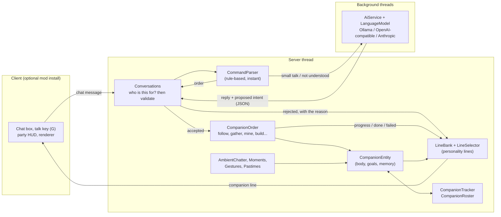
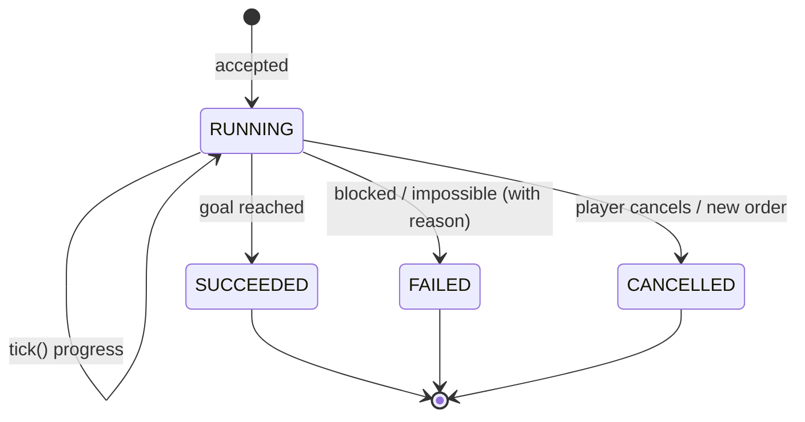

# Architecture

This is how Hearthbound Companions fits together, and why I built it this way. Everything hangs
off one rule: talking and doing are separate systems. Dialogue (scripted or from an AI model) can
only *propose* a structured intent. Plain game code checks it, runs it, and is the only thing that
decides what a companion is actually doing.

## Big picture

## Layers

| Layer | Package | Depends on Minecraft? | Purpose |
|---|---|---|---|
| Core logic | `hearthbound.core.*` | No | Intent model and command parser, reading answers, personalities and the named cast, line banks and line filling, memory (conversation, events, what each player told them), the gather state machine, prompt building and the JSON contract for AI replies. It's plain Java, so the JUnit tests run fast. |
| Game integration | `hearthbound.entity`, `hearthbound.entity.order`, `hearthbound.dialogue`, `hearthbound.world` | Yes (server) | The companion entity and its goals, the orders (follow, wait, come, gather, give, attack, mine, build, home), chat routing and validation, unprompted chatter and reactions, the roster, hub residents and world rules. |
| AI providers | `hearthbound.ai`, `hearthbound.core.ai` | Only for the glue (`java.net.http` + Gson do the work) | Async HTTP clients for Ollama, OpenAI-compatible APIs and Anthropic, rate limiting, and the check that stops a model promising things the game won't do. Never called on the game thread. |
| Server mode | `hearthbound.server`, `hearthbound.server.polymer` | Yes | Shows companions to unmodded players as vanilla mannequins through Polymer, with signed skins. |
| Networking | `hearthbound.network` | Yes | The party status packet for the HUD. |
| Client | `hearthbound.client` | Yes (client only) | Renderer using the game's own default skins and the cast skins, the party HUD, the talk key. |
| Mixins | `hearthbound.mixin` | Yes | One small hook: noticing when a player completes an advancement, which Fabric API has no event for. |

## How a message flows

1. You type *"Hazel, gather 16 oak logs"* (or `@Hazel ...`, or just keep chatting once you've
   started a conversation). Fabric's chat event hands it to `Conversations.onChat` on the server
   thread, which works out who it's for: a name at the start, an `@name` anywhere, `@all`, or the
   companion you're already talking to.
2. `CommandParser` (rule-based, a few microseconds) turns it into one of: an order
   (`gather(item="oak logs", count=16)`), small talk with a topic, something about yourself
   ("call me Captain"), an unclear or unsupported request, or nothing it recognises.
3. For an order, `Conversations.apply` checks it against the real world. Is it a known item, can it
   be gathered, is the count sane, does the companion have a pickaxe, is the build site flat and do
   they carry enough blocks, are they downed, do they belong to someone else?
4. If it's accepted, the matching `CompanionOrder` starts, and only *then* does the companion reply,
   already knowing the real outcome. If it's rejected, the reply explains the real reason.
5. Small talk, or a message the parser can't place, goes to the AI if one is configured. The model
   returns JSON: `{"reply": "...", "intent": ...}`. A proposed intent goes through the same check in
   step 3, and `CommitmentGuard` catches replies that promise an action the model didn't actually
   propose. If anything fails, the model's reply gets thrown away and the companion gives a truthful
   answer from their own lines instead. With no AI, the personality's scripted lines answer.
6. While an order runs, the order itself (not the dialogue) sends progress with exact numbers.
   "Done" is only announced once the order's own state reaches `SUCCEEDED`.

## Orders

Each companion has exactly one order at a time. Follow, wait and home are *modes* that never
finish; gather, give, come, attack, mine and build are *tasks* that end, after which the companion
goes back to its mode. Mining and gathering share `BlockWork`, which breaks a block the slow,
visible way (cracks, swings, tool wear) and collects what drops. Building lays out a `Blueprint`
in front of the player and checks the whole site before agreeing to anything.

Around the order, a few goals are always on: recovering when downed, retreating when badly hurt,
defending the owner and helping them fight, avoiding creepers, and catching up after a teleport.
A goal can take over movement for a bit (to fight a zombie, say) and then hands control back.

## Things they do without being asked

- `AmbientChatter` runs once a second per player: warnings (creeper, something behind you, low
  health, lava), comments on the weather, time, biome and nearby ores, suggestions (eat, find
  shelter), handing over food or a flower, and sometimes a question about you.
- `Moments` reacts to what happens to the player: advancements (through the mixin), level
  milestones, diamonds, going to bed, waking up, dying and respawning.
- `Gestures` watches the sneak key, so two quick crouches at a companion get a crouch back.
- `Pastimes` gives idle companions something real to do: study a flower, pet a cow, pick up loot,
  walk a guard circuit, stargaze.

Everything here goes through the same line banks, with cooldowns so nobody talks over anyone.

## Daily life at home

A companion who isn't travelling with anyone runs a `HomeOrder`, and with daily life on that order
hands each tick to a `DailyRoutine`:

- Every three seconds (staggered per companion) it reads the clock and asks `core.life.Schedule` what
  they should be doing: sleep, getting up, work, a meal, leisure, the evening together, or shelter from
  the rain. The schedule is plain Java, shaped by the personality, a per-companion seed, and their
  `Needs` (hunger, tiredness, loneliness), so it's covered by JUnit tests.
- In between it walks them to the right place and does the thing there: lies down in their bed with
  `startSleeping`, eats from their pack, works by role (farm chores, the usual autonomy jobs, a guardian's
  rounds), or stands with the others at the meeting spot.
- `HomeAreas` (`<world>/data/hearthbound_places.json`) groups homes within 32 blocks into one area and
  keeps its places: what a scan of the surroundings found (`PlaceScan`, at most once a second for one
  area, every couple of minutes per area), what a player marked with `setplace`, and the hub's config.
  It also keeps claimed beds, players' beds, friendships between companions, storehouse chests, and the
  game time each area was last live.
- `LifeTicker` runs once a second for each area with someone loaded: it notices when an area comes back
  after a long gap and runs `CatchUp` (crop growth from `core.life.CropGrowth`, harvests into storage only),
  lights and puts out the meeting fire, starts group moments through `Exchanges`, and lets friendships grow.
- `Initiative` is what a resident does about a brand-new world with autonomy on (a shelter, a farm by
  water, a hoe from a couple of logs), each tried at most every few days, and otherwise says what's missing
  once a day.

Plain requests with nobody named ("let's build a house") are read by `core.intent.TeamRequest` and run
by `TeamJob`: one blueprint and one list of open spots that several builders claim from, with
collectors' `GatherOrder`s delivering to the builders and guardians on a `Watch` order round the site.

## Memory

`CompanionMemory` holds the recent conversation (only with the current speaker, so one player's
words never reach another player or an AI prompt written for them), a dozen notable shared events
written by game code ("I built a shelter with {player}") and an affinity score. It also keeps
`PlayerFacts` for each player: the name they asked to be called, plus a few likes and dislikes.
Facts only ever come from the player's own words, and get matched against the world later (a like
of "the ocean" matches a deep ocean biome; "spiders" matches a cave spider).

## Persistence

`CompanionEntity` saves its own state with the chunk, like any mob: personality, skin, owner,
current mode and any unfinished gathering, inventory, memory and facts.

`CompanionRoster` (`<world>/data/hearthbound_roster.json`) keeps a small record of every companion
in the world even while their chunk isn't loaded: name, cast member, owner and whether they live at
the hub. It's used for the party limit, for never spawning a cast member twice, and for the hub.
`HomeAreas` (`<world>/data/hearthbound_places.json`) keeps the homes and their places (above).
`CompanionTracker` keeps the set of currently loaded companions so nothing has to scan every
entity in every level.

## Threading rules

* Everything that touches the world runs on the server thread.
* AI requests use `HttpClient.sendAsync` with timeouts. The result is handed back with
  `server.execute(...)` and re-checked before anything is shown: is the companion still alive,
  still talking to this player, and is this still the latest message?
* If the AI is slow, busy or offline, the scripted lines answer instead, and orders carry on as normal.
