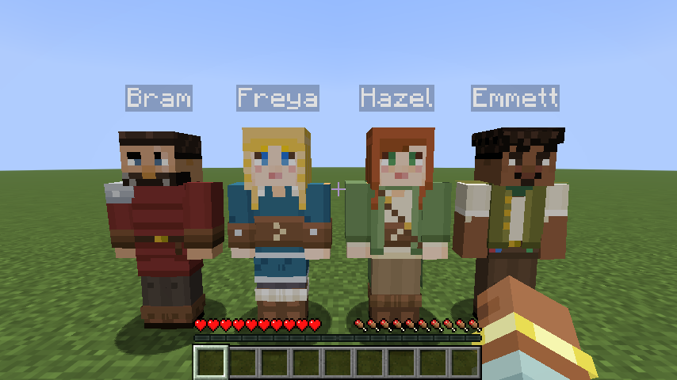
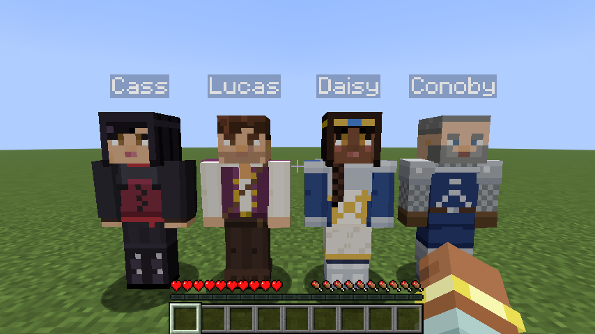
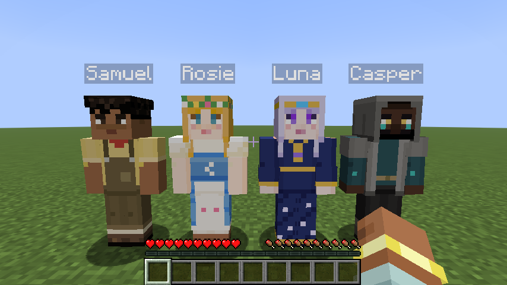

# The cast

Twelve original characters, two for each personality (one woman and one man), each with a skin
I designed for them. When a companion spawns you'll usually meet one of these; about one in four
is a wanderer wearing one of the game's default skins instead. Every cast member has a fixed
name, look, personality and short backstory, and the backstory also goes into the AI character
sheet so they stay consistent.

| Name | Personality | Look | Who they are |
|---|---|---|---|
| **Freya** (she/her, slim) | Sellsword | Long golden hair with thin braids framing her face; teal tunic with silver trim, laced leather corset, white fur mantle, fur-topped boots | A shieldmaiden from the north who left her clan to see the world |
| **Bram** (he/him) | Sellsword | Short dark hair, salt-and-pepper beard, scar over the brow; oxblood quilted gambeson over mail, one steel pauldron | A scarred veteran who has outlived three mercenary companies |
| **Hazel** (she/her, slim) | Naturalist | Long auburn hair with a white flower, freckles, green eyes; sage coat over a cream blouse and laced corset, satchel strap | A scholar-ranger who sketches every creature and flower she meets |
| **Emmett** (he/him) | Naturalist | Dark curls, goatee, a sprig of herbs behind his ear; olive vest, rolled sleeves, green neckerchief, little vials on his belt | A soft-spoken herbalist who knows every root and leaf |
| **Cass** (she/her, slim) | Rogue | High dark ponytail, side-swept bangs, amber eyes; burgundy laced corset, cropped black leather jacket, crimson sash, thigh-high boots | A sharp-tongued treasure hunter with a few too many tomb stories |
| **Lucas** (he/him) | Rogue | Tousled chestnut hair, stubble, gold earring; plum doublet with brass buttons over a loose white shirt, bandolier | A silver-tongued thief with a weakness for shiny things |
| **Daisy** (she/her, slim) | Guardian | Long dark braid over one shoulder, gold circlet; silver breastplate with gold trim, white tabard with a golden sun, royal-blue cape | A paladin of the Dawn, sworn to guard travellers on the wild roads |
| **Conoby** (he/him) | Guardian | Grey crop and full grey beard; deep-blue surcoat with a silver chevron over mail, steel pauldrons | An old knight-protector who won't lose another friend |
| **Rosie** (she/her, slim) | Farmhand | Honey-blonde waves and a flower crown, freckles; cream puff-sleeved blouse, sky-blue laced dress, white apron with embroidered flowers | A sunny farm girl who calms animals and bakes when she's nervous |
| **Samuel** (he/him) | Farmhand | Black curls, freckles; faded yellow shirt, patched brown overalls, red kerchief, rolled cuffs, muddy boots | A farm lad still not sure leaving home was a good idea |
| **Luna** (she/her, slim) | Mystic | Waist-length silver-lavender hair, violet eyes, gold circlet with a blue gem; midnight gown with gold trim and stars, amethyst amulet | A stargazer who reads omens in the night sky |
| **Casper** (he/him) | Mystic | Ash-grey hood up, amber eyes, glowing teal rune marks; teal tunic, rope belt, wrapped boots | A hooded seer who speaks rarely and notices everything |

## Design notes

- **Faces:** the women have taller eyes with lashes and a catch-light, a soft blush and small
  rosy lips; long hair frames the face on the outer layer and falls down the back and over the
  shoulders. The men keep simpler, sturdier faces with brows, beards and stubble.
- **Readable at a distance:** each character has a signature colour (Freya's teal, Bram's
  oxblood, Hazel's sage, Cass's burgundy, Daisy's white and gold, Luna's midnight blue) and a
  silhouette detail on the outer layer, such as a fur mantle, hood, ponytail, cape or crown.
- **Practical adventuring gear:** belts, straps, corsets, bracers and boots rather than
  over-the-top costumes, in the spirit of classic fantasy adventures.
- **Shading:** a four-step colour ramp per material, with cooler shadows and warmer highlights,
  side and back faces a little darker, and no random noise.
- **Checked in the game:** front and back line-ups, close-ups and a running shot
  ([walking](images/cast/walking.png), [back view](images/cast/lineup-back.png)). The flat sheet
  of all twelve, front and back: [skin-sheet.png](images/cast/skin-sheet.png).

The skins are generated by [`tools/skins/cast.py`](../tools/skins/cast.py) (plain Python, no
dependencies). The men are in `cast.py` and the women in [`women.py`](../tools/skins/women.py),
built from reusable pieces in [`pieces.py`](../tools/skins/pieces.py) and
[`details.py`](../tools/skins/details.py). Change a colour and run `python tools/skins/cast.py` to
regenerate. They're original art, MIT-licensed with the rest of the repo.

## Names

The twelve cast names are reserved for these characters. Wanderers use separate name pools per
personality, cleaned up so no two names are easy to confuse in chat.

## Commands

- `/companion summon hazel` summons a specific cast member (with cheats on).
- `/companion skin <name> <outfit>` changes a companion's look to a default skin (`noor slim`)
  or a cast outfit (`daisy`).
